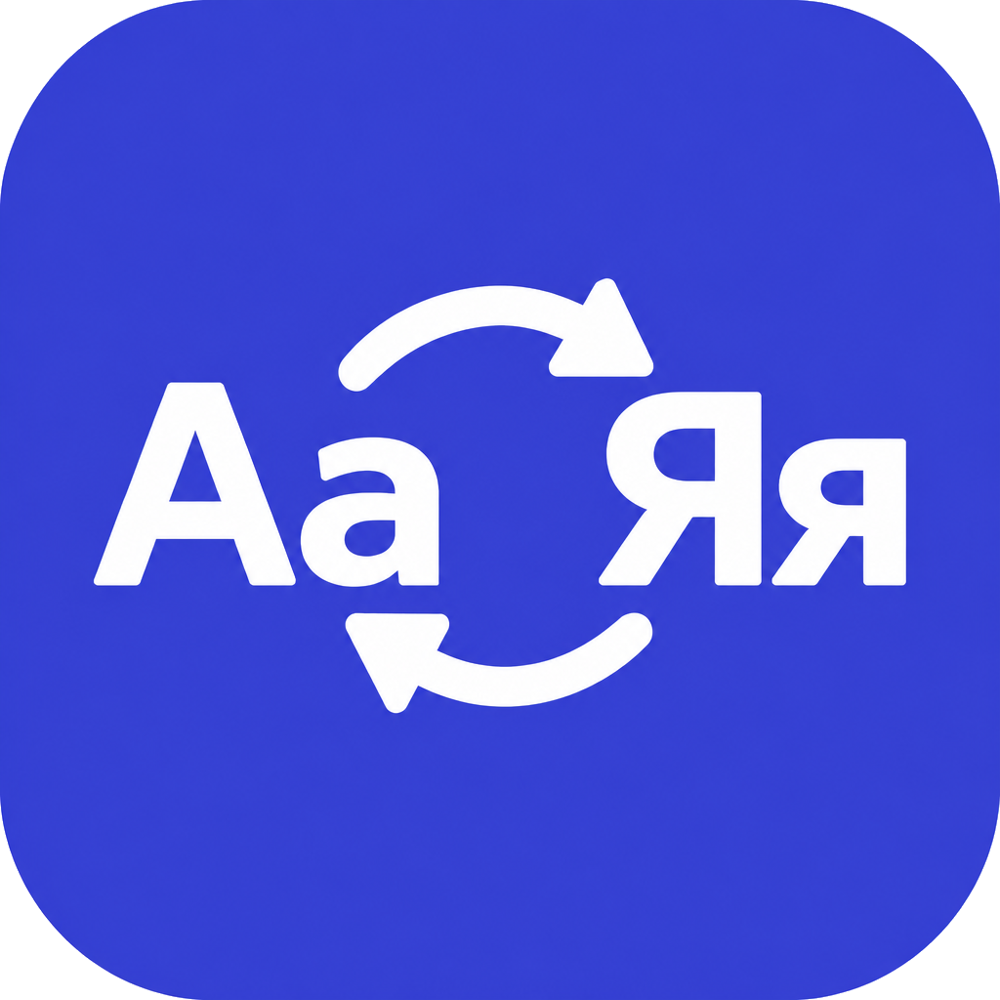

<div align="center">



# Rasklad

**RU** / [EN](README.md)

Небольшая утилита в трее Windows, которая переключает раскладку клавиатуры по горячей клавише.

[](https://github.com/ProcessdNN/rasklad/releases)
[](https://github.com/ProcessdNN/rasklad/actions/workflows/ci.yml)
[]()
[]()
[](LICENSE)

</div>

> Это перевод. Эталонная версия — [английская](README.md).

## Обзор

Caps Lock на большинстве клавиатур простаивает. Rasklad превращает его в
переключатель раскладки: нажимаете клавишу, раскладка меняется, а сама клавиша
до приложения не доходит, поэтому режим капса не включается случайно.

Приложение живёт в области уведомлений и не показывает окно, пока вы не откроете
настройки. Это один exe: без установщика, без зависимостей и без доступа в сеть.

## Возможности

- **Любая горячая клавиша.** Запишите сочетание вроде `Ctrl+Space` или `Alt+Q`
  либо клавишу, которая работает сама по себе: `F13`, `PrintScreen`. Один
  модификатор без основной клавиши или буква без модификатора не принимаются,
  и окно объясняет причину.
- **Переключение не зависит от системного хоткея.** Rasklad просит активное окно
  переключиться на следующую раскладку вместо того, чтобы нажимать `Alt+Shift`
  за вас. Работает там, где эта комбинация отвязана и остался только `Win+Space`,
  и обходится без всплывающего оверлея языка.
- **Режим капса на ваш выбор.** `Shift+Caps` по умолчанию, либо `Ctrl`, `Alt`,
  `Win`, либо выключено.
- **Автозапуск с проверкой.** Реестр, папка «Автозагрузка» или задача
  планировщика. При каждом старте запись перечитывается: мёртвая создаётся
  заново, указывающая на другую сборку показывается в окне.
- **Сначала трей.** Левый клик открывает настройки, правый открывает меню.
  Закрытие окна оставляет приложение работать.
- **Один экземпляр.** Повторный запуск exe открывает окно уже работающей копии.
- **Без сети.** Ни телеметрии, ни проверки обновлений, ни HTTP-клиента в
  зависимостях.

## Установка

Скачайте `rasklad.exe` из
[**Releases**](https://github.com/ProcessdNN/rasklad/releases) и запустите.
Больше ничего не нужно: ни установщика, ни рантайма, ни распространяемого пакета.

Windows 10 и 11, 64 бита.

Первый запуск открывает окно настроек. Включите там автозапуск, если хотите,
чтобы приложение возвращалось после перезагрузки.

## Использование

- Нажмите горячую клавишу в любом приложении. Раскладка переключится, клавиша до
  приложения не дойдёт.
- `Win+Caps` включает и выключает режим капса, либо то сочетание, которое выбрано
  в Advanced.
- Левый клик по иконке в трее открывает настройки, правый открывает меню,
  средний включает и выключает горячую клавишу.

## Настройки

| Элемент | Что делает |
|---|---|
| Enabled | Главный выключатель горячей клавиши. |
| Hotkey, Record | Нажмите сочетание. `Esc` отменяет запись. |
| `⋯` → Autostart | Ключ в реестре, ярлык в «Автозагрузке» или задача планировщика. |
| `⋯` → Advanced | Какое сочетание переключает режим капса. |
| `⋯` → Exit | Выход. Закрытие окна только скрывает его. |

Файл настроек: `%APPDATA%\rasklad\config.json`.

## Сборка

```
cargo build --release
```

Нужен стабильный Rust с тулчейном `x86_64-pc-windows-msvc` (вариант
`x86_64-pc-windows-gnu` тоже работает). Готовый exe появится в `target\release`.

## Как это устроено

- Хук `WH_KEYBOARD_LL` на отдельном потоке следит за нажатиями и съедает
  сработавшую клавишу.
- Раскладка переключается сообщением `WM_INPUTLANGCHANGEREQUEST` активному окну.
  Если окно запущено с правами администратора, сообщение блокируется, и тогда
  инжектится `Win+Space`.
- Состояние модификаторов читается через `GetAsyncKeyState` на каждое событие.
  Ничего не накапливается, поэтому пропущенное отпускание клавиши не оставляет
  хоткей залипшим.
- Записи автозапуска перечитываются при старте, так и замечается устаревший ключ
  в реестре или ярлык.

## Известные ограничения

- Горячая клавиша не срабатывает, пока в фокусе окно самого rasklad. Windows не
  передаёт такие нажатия в хук. На запись хоткея это не влияет: она читает
  состояние клавиш напрямую.
- Для переключения раскладки в окне, запущенном от администратора, нужен сам
  rasklad с правами администратора. Окно настроек это определяет и предлагает
  перезапуск с повышением прав.

## Участие

Патчи приветствуются, смотрите [CONTRIBUTING.md](CONTRIBUTING.md). Вопросы и
отчёты — через [SUPPORT.md](SUPPORT.md), проблемы безопасности — через
[SECURITY.md](SECURITY.md).

## Лицензия

GPL-3.0, смотрите [LICENSE](LICENSE). Код, закоммиченный до перелицензирования в
v0.2.0, публиковался под MIT.
